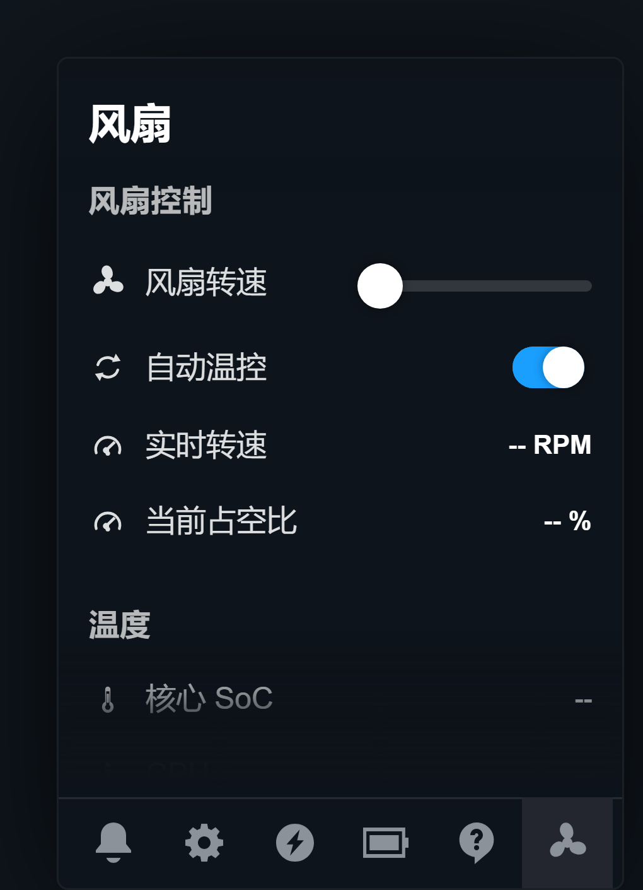

# Steam Frame 快速设置菜单「风扇」页 —— 安装说明

在 Steam Frame 的**快速设置菜单（QAM）**底部标签栏里，紧挨着「?」帮助气泡右边加一个
风扇图标；点开后可以看实时温度、实时转速，也可以手动设定风扇转速。

```
    🔔   ⚙   ⚡   🔋   ❓   ✿
                          ↑ 新增的风扇标签
```



---

## 一、先确认你符合条件

| 需要 | 说明 |
| --- | --- |
| Steam Frame（Deckard）开发机 | 正式零售版如果风扇控制器不同，安装脚本会直接告诉你并拒绝安装 |
| 能在这台机器上开终端 | 桌面模式下按 `Ctrl`+`Alt`+`T`；或者用 SSH 登录 |
| 有 sudo 密码 | 写风扇转速需要 root |

> 安装脚本会在动手之前把上面这些都检查一遍。**不满足条件它不会装**，
> 所以不用担心把机器弄坏。

---

## 二、安装（三步）

### 1. 把整个文件夹拷到设备上

**方法 A —— U 盘（不用 SSH）**

设备桌面模式下插上 U 盘，用文件管理器（Dolphin）把 `sf-fan-qam-1.0.0`
文件夹拖到主目录。然后在设备上开一个终端：桌面模式下按 `Ctrl`+`Alt`+`T`，
或者按 `Ctrl`+`Alt`+`F1` 切到控制台登录。

**方法 B —— 从电脑 scp**

```bash
# 在你自己的电脑上执行（把 IP 换成设备的）
scp -r sf-fan-qam-1.0.0 steamos@<设备IP>:~/
```

**方法 C —— 设备上直接解压**

```bash
tar xzf sf-fan-qam-1.0.0.tar.gz
cd sf-fan-qam-1.0.0
```

### 2. 跑安装脚本

```bash
cd ~/sf-fan-qam-1.0.0
sudo ./install.sh
```

脚本会依次告诉你每一步在干什么，最后会打印「安装完成」。
如果中途哪一步不对，它会**明确说明是哪里不对**，并且不会把系统留在半装状态。

### 3. 戴上头显看一眼

打开快速设置菜单（点底部栏的**电池图标**），在「?」右边应该多出一个风扇图标。
点进去就是面板。

> 如果装的时候 SteamVR 没开，脚本会提示「还没注入成功」——这是正常的。
> 启动 SteamVR 之后几秒钟它会自动接上，**不需要重装**。

---

## 三、卸载（一条命令）

```bash
cd ~/sf-fan-qam-1.0.0
sudo ./uninstall.sh
```

卸载脚本会：停服务 → 把风扇交回系统自动温控 → 删掉所有装上去的文件 →
**验证**系统温控确实恢复了（会打印 `pwm1` 和转速给你看）。

界面上的标签会在 QAM 下次重新渲染时消失，最迟重启一次 SteamVR 就没有了。
风扇控制则立刻恢复成出厂状态。

---

## 四、出问题了怎么办

先跑诊断脚本，它只读、不改任何东西：

```bash
cd ~/sf-fan-qam-1.0.0
sudo ./diagnose.sh > sf-fan.log 2>&1
```

然后把 `sf-fan.log` 发给作者。它会检查：风扇硬件、原生温控服务、面板服务、
SteamVR/GamepadUI 进程、CEF 调试端口、装上去的文件、最近日志、内核风扇消息，
最后给出结论。

### 常见情况

**看不到风扇标签**
1. 先确认 QAM 是从**电池图标**打开的（不是底部大栏）；
2. `journalctl -u sf-fan-qamd.service -n 20` 看有没有 `inject -> xxxx`；
3. 没有的话多半是 SteamVR 没起来，或者装完之后没有重启过 SteamVR。

**风扇图标在，但点开是空的**
在 QAM 里随便点一下「设置」标签再点回风扇标签。面板需要从原生标签页里克隆行样式，
第一次打开时可能需要一两次渲染。

**「实时转速」的数字大概三秒才跳一次**
这是**硬件**的节奏，不是面板慢。实测：面板从拿到数据到画到屏幕上是 0.6 秒以内，
但风扇控制器本身大约每 3 秒才产出一个新的转速读数（内核里加了测速窗口，
`dmesg` 里能看到 `tach did not complete in expected period`）。
换句话说界面上已经是最新的了，再快也没有新数据可显示。

**手动调了转速，过一会儿自己变回去了**
这是保护机制在起作用，三种情况会把手动模式交回系统：
1. SoC 温度 ≥ 88 °C（面板上会提示「温度过高，已自动恢复系统温控」）；
2. 你把「自动温控」开关打开了；
3. 服务被停掉或崩了（单元里的 `ExecStopPost` 兜底）。

如果你没有触发上面任何一条但它还是自己变回自动了，请把 `sf-fan.log` 发我。

---

## 五、安全说明

- **手动模式的最低转速是 20 %，且永远不会写出 0。** 这颗 Delta 风扇在 20 % 以下
  会失速，原生控制器的下限也是 30 %，所以滑杆拖到最左边也只会到 20 %。
- **装了之后不影响原生温控。** 手动模式只是临时把原生控制器停下并接管 `pwm1`；
  一旦切回自动、温度过高、或者服务退出，原生控制器立刻拿回控制权。
- **卸载后系统完全恢复原状**，没有改任何系统文件（只往
  `/home/steamos/sf-fan-qam/` 放文件、往 `/etc/systemd/system/` 放一个单元）。
- 整个程序只用 Python 标准库，不联网，不装任何额外依赖。

---

## 六、这个包是怎么装的（给好奇的人）

| 文件 | 作用 |
| --- | --- |
| `install.sh` | 一键安装，带完整前置检查和安装后验证 |
| `uninstall.sh` | 一键卸载，带卸载后验证 |
| `diagnose.sh` | 只读诊断，出问题先跑这个 |
| `device/sf_fan_qam.js` | 注入到 QAM 页面的前端脚本 |
| `device/sf_fan_qamd.py` | root 守护进程，读传感器、写 `pwm1`、注入前端 |
| `device/sf-fan-qamd.service` | systemd 单元 |
| `docs/TECHNICAL.md` | 完整的技术文档（原理、调试工具、所有踩过的坑） |
| `docs/device-tools/` | 可以直接在设备上跑的调试脚本（改代码时才需要） |

装到设备上的位置：

```
/home/steamos/sf-fan-qam/                 程序本体
/etc/systemd/system/sf-fan-qamd.service   服务单元
```

---

## 七、反馈

请把这两样发我：

1. `sudo ./diagnose.sh > sf-fan.log 2>&1` 的输出；
2. 具体现象（哪个按钮、点了之后你看到什么、你期望看到什么）。

有截图或录屏更好。
